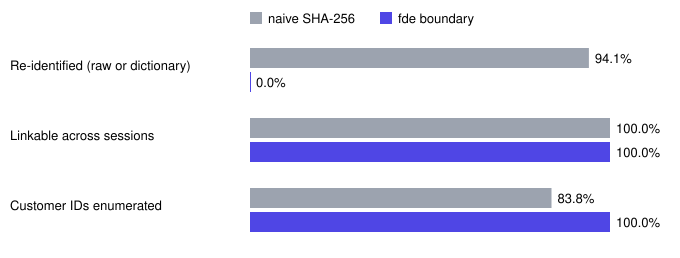
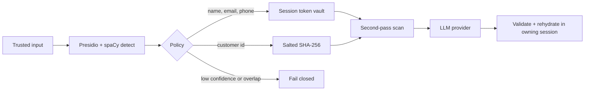

# fde-pii-hashing

[](https://github.com/PeterP22/fde-pii-hashing/actions/workflows/ci.yml)
[](LICENSE)

A local trust boundary that detects, tokenizes and hashes PII before any LLM call, tested against a curious provider.

**0.0% of PII re-identified from provider payloads, vs 94.1% for a naive unsalted SHA-256 pipeline** (1,600 synthetic PII values, 1M-entry dictionary attack).





## Key decisions

- **Tokens, not hashes, for names, emails and phones.** Tokens are random per session and reversible only inside it, so a dictionary attack has nothing to match.
- **Customer IDs get a keyed hash.** The pseudonym is stable, so it can be joined across requests, but it can't be reversed without the salt.
- **Fail closed.** Low-confidence or overlapping detections block the request, and the outbound text is scanned a second time before it leaves.
- **What didn't work:** salted SHA-256 over a 1M-value ID space. Once the salt leaks, every hashed customer ID (128/128) is recovered by enumeration. Fail-closed also costs utility: 68% of varied phrasings were blocked, mostly by spaCy-sm span overlaps and low phone confidence.

## Results

Run `uv run python -m fde_privacy.leak_eval`: 200 people × 2 requests, seed 20261017. The attacker sees only the serialized provider payloads. Raw output is in [results/leak_eval.json](results/leak_eval.json).

| Attack | Naive SHA-256 | fde boundary |
|---|---:|---:|
| Raw PII in payload | 48 / 1,600 | 0 / 1,600 |
| Dictionary re-identification | 1,458 / 1,600 | 0 / 1,600 |
| **Total leak rate** | **94.1%** | **0.0%** |
| Same person linkable across sessions | 100% | 100% (via customer-ID hash) |
| Customer IDs brute-forced | 335 / 400 (no secret needed) | 128 / 128 (only if the salt leaks) |
| Raw PII in 28,107 log records and errors | not scanned | 0 |
| Requests served | 100% | 32% |

## Quickstart

```bash
uv sync
uv run pytest -m "not integration"
uv run python -m fde_privacy.leak_eval
```

Background, demos and the gateway setup are in the [guide](docs/guide.md). Threats and controls are in the [threat model](docs/threat-model.md).
